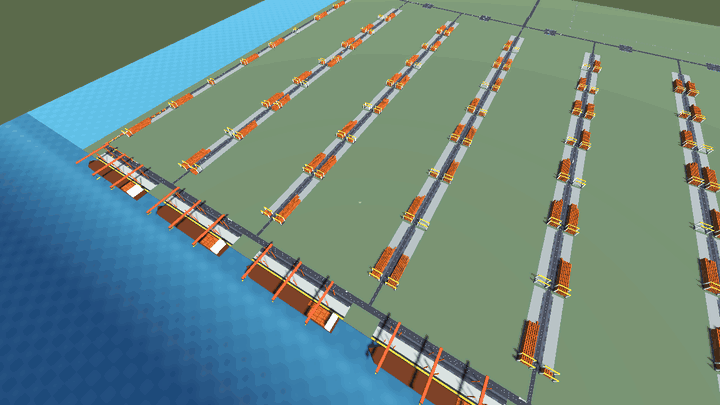
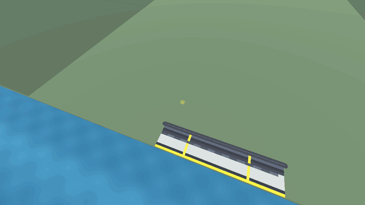
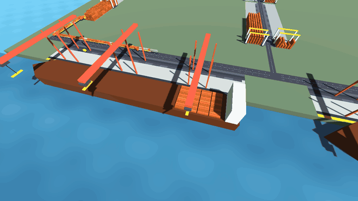
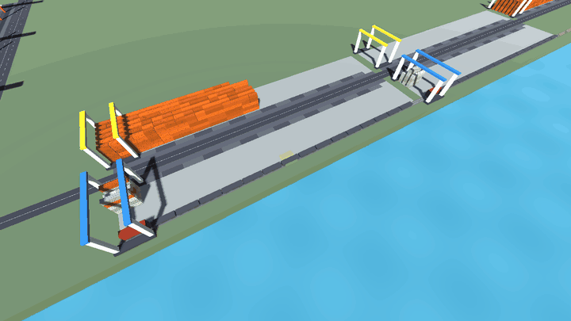
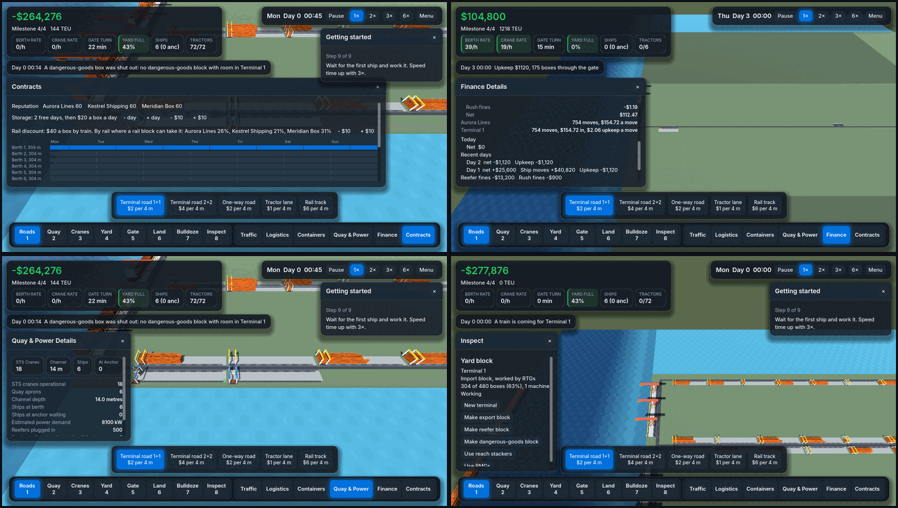
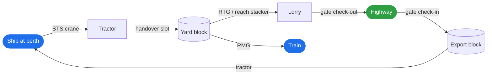
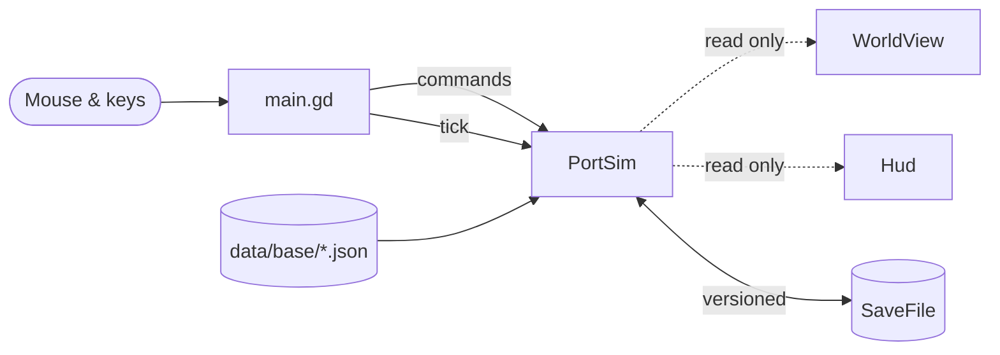

<div align="center">

# Port Skylines

**Design a container terminal on a 4 m grid, then watch every box move through it.**

[](https://github.com/JFrusher/PortSkylines/actions/workflows/ci.yml)
[](https://godotengine.org/download)
[](scripts/)
[](#windows-build)
[](docs/phases/m06-scale-and-rail.md)



<sub>The Mega port: 6 berths, 18 STS cranes, 80 RTG yard blocks holding 20,000 boxes, 12 gates and two rail yards, every box simulated.</sub>

[Play](#play) · [Features](#features) · [How a box moves](#how-a-box-moves) · [Progression](#progression) · [Roadmap](#roadmap) · [Develop](#develop)

</div>

---

Port Skylines is a port-building game in the spirit of city builders. You lay out berths, roads, gates and yard blocks; shipping lines bring weekly calls; and an honest, deterministic simulation moves each container by crane, tractor, yard machine, lorry and train. Your throughput is whatever your layout earns.

> [!NOTE]
> Port Skylines is in active development. Phases M1 to M5 are complete. M6 (scale and on-dock rail) has all of its features in, and is waiting on its performance target before it is tagged. See [Roadmap](#roadmap).

## Features

<table>
<tr>
<td width="50%" valign="top">

### Build on a 4 m grid
Click a **berth** onto the coast: feeder (200 m), Panamax (300 m) or Neopanamax (400 m). Each brings its own road and marked **crane spots**. Draw roads from the highway, then drag **gates** and **yard blocks** out along them.



</td>
<td width="50%" valign="top">

### Work ships at true scale
**STS cranes** stand on 30.5 m rails and reach across the widest ship their kind serves. Deck stacks are drawn box by box, as many rows across as the ship class carries. Tractors shuttle each box to a handover slot.



</td>
</tr>
<tr>
<td width="50%" valign="top">

### Take trucks off the road with rail
**RMG rail yards** load and unload trains at their sidings. Trains run to a timetable, book the level crossings they cover, and take the imports booked to rail. A **rail discount** shifts each line's modal split.



</td>
<td width="50%" valign="top">

### Run it as a business
Lines offer **weekly services** for berth windows, and the week is planned berth by berth with clashes in red. Every dollar goes through the **ledger**, and **money per crane move** shows income and cost by line and by terminal.



</td>
</tr>
</table>

<details>
<summary><b>Everything else in the simulation</b></summary>

<br>

| System | What it does |
|---|---|
| **Traffic** | Lanes on 0°, 45° and 90° roads, one vehicle per cell, junctions that form by themselves, and gate queues that back up onto the public road |
| **Yard** | Reach stackers, RTGs and RMGs stack to their own heights, dig out buried boxes, and work handover slots in turn |
| **Gates** | Manual, OCR and automated gate levels, one-way or two-way, with check-in times from the data |
| **Contracts** | Three shipping lines with liveries, reputation, berth windows, late calls and cancellations |
| **Hinterland** | Every box has an off-map origin or destination, reached by road or by rail, with demand that grows with each milestone |
| **Reefers** | Plugged in reefer blocks, drawing 4 kW (7 kW on hot days), billed on the day's peak, and fined when left unplugged |
| **Special cargo** | Rush imports fined when their call is late; dangerous goods only in their own blocks, kept apart from the rest |
| **Economy** | Move prices, storage fees past free days, upkeep by terminal, loans, a bailout, and an end-of-year scoreboard |
| **Ships** | Feeder, Panamax and Neopanamax, gated by channel depth, berth length and crane outreach; dredging deepens the channel |
| **Saves** | Versioned save files that migrate every older version, each one kept as a test fixture |

</details>

## How a box moves



Imports leave the ship by **STS crane** onto a **tractor**, which hands them over at a **yard block** slot. They wait there for their dwell time, then go out by **lorry** through the gate or by **train** from an RMG siding. Exports run the same chain backwards. Every step is a timed job in a fixed-tick, deterministic sim, so the same commands always give the same port.

## Progression

Milestones count the TEU moved across the quay. Each one unlocks new content and raises hinterland demand.

| Milestone | TEU | Unlocks |
|:--|--:|:--|
| ⚓ **Harbour** | 0 | Contracts with shipping lines · feeder services · reach stackers · the ledger |
| 🏗️ **Terminal** | 200 | Loans · RTG cranes · OCR gate portals |
| 🚢 **Gateway** | 600 | Land · dredging · Panamax services · automated gates · rail track and RMG yards |
| 🌐 **Hub** | 1,500 | Neopanamax services and berths · wide STS cranes |

A guided start walks a new port from its first berth to its first worked ship on the $20,000 start money. **Creative mode** lifts the money limit.

## Play

You need **[Godot 4.7.2](https://godotengine.org/download)** (the standard build, not .NET). Open `project.godot` and press <kbd>F5</kbd>.

| Input | Action |
|:--|:--|
| <kbd>Left click</kbd> / drag | Place a berth, draw a road, drag an area along a road, place a crane, bulldoze |
| <kbd>W</kbd> <kbd>A</kbd> <kbd>S</kbd> <kbd>D</kbd> / arrow keys | Pan |
| <kbd>Q</kbd> / <kbd>E</kbd> | Rotate |
| Mouse wheel | Zoom |
| <kbd>1</kbd> to <kbd>8</kbd> | Roads, Quay, Cranes, Yard, Gate, Land, Bulldoze, Inspect |
| <kbd>Esc</kbd> | Game menu; also stops following a box |

> [!TIP]
> Want to see everything at once? In a debug run (from the editor), **Menu → Mega port (debug)** loads the big test port with every milestone reached, rail running and the yards full.

### Windows build

Every pushed tag makes CI build `PortSkylines-<tag>-windows.zip` as a workflow artifact. `export_presets.cfg` has one preset, `Windows`, with the shader baker on so shaders compile at export rather than stuttering on first use. CI exports headless, without a GPU, so it skips the baker; for a baked build, export from the Godot editor on a machine with a GPU:

```bash
godot --export-release "Windows" build/windows/PortSkylines.exe
```

## Roadmap

| | Phase | Status |
|:-:|:--|:--|
| ✅ | [M1 Foundations](docs/phases/m01-foundations.md): fixed ticks, versioned saves, data-driven content | Done |
| ✅ | [M2 A real terminal loop](docs/phases/m02-terminal-loop.md): berth windows, crane rates, yard, gate | Done |
| ✅ | [M3 Contracts, economy and progression](docs/phases/m03-economy-progression.md) | Done |
| ✅ | [M4 Vertical slice and art](docs/phases/m04-vertical-slice.md) | Done |
| ✅ | [M5 Roads and areas](docs/phases/m05-roads-and-areas.md): the 4 m grid, lanes and terminals | Done |
| 🟧 | [M6 Scale and on-dock rail](docs/phases/m06-scale-and-rail.md): endgame scale, rail, reefers, Neopanamax | Features in; performance target open |
| ⬜ | [M7 CS2-style cost routing](docs/phases/m07-cost-routing.md) | Planned |
| ⬜ | [M8 The whole port](docs/phases/m08-whole-port.md) | Planned |
| ⬜ | [M9 Barge and feeder transhipment](docs/phases/m09-barge-and-feeder.md) | Planned |
| ⬜ | [M10 Events and regulations](docs/phases/m10-events.md) | Planned |
| ⬜ | [M11 Policies, rules and automation](docs/phases/m11-automation.md) | Planned |
| ⬜ | [M12 Release 1.0 on Windows](docs/phases/m12-release.md) | Planned |

> [!IMPORTANT]
> M6's exit target is 60 fps at 1080p on a GTX 1660-class PC with the endgame port at 1×. Today the sim tick at that load is 32 ms on a 2.1 GHz cloud CPU, so it is not met yet. The measurements and the options are in [docs/perf.md](docs/perf.md).

The research behind the plan, from rivals to real terminal maths, is in [docs/ROADMAP.md](docs/ROADMAP.md).

## Develop

The sim is plain typed GDScript with no engine nodes. It changes only through `PortSim.apply(command)` and `PortSim.tick()`, and the view only reads it. That keeps it deterministic: a replay test checks that the same command log gives the same state hash at 1, 3 and 6 ticks a frame.



### Tests

```bash
godot --headless --import
for t in tests/test_*.gd; do timeout 300 godot --headless --script "res://$t"; done
```

Each test prints `tests: N failure(s)` and exits non-zero on failure, and CI also fails on any `SCRIPT ERROR` or `ERROR` line. The suite covers the rules, roads and traffic, rail, cargo, berths, the guided start, replay determinism, every save fixture and a two-day soak with invariants checked every tick. See [tests/README.md](tests/README.md) for each test, the fixtures and the benchmarks.

### Content

Every tunable number lives in `data/base/*.json`, which covers rules, ships, berths, equipment, roads, areas, lines and the hinterland. The loader checks each key's type and fails with the file and key named. All keys are documented in [docs/content.md](docs/content.md).

<details>
<summary><b>Project layout</b></summary>

<br>

| Path | Role |
|:--|:--|
| `art/`, `assets/` | Blender sources (Git LFS) and the `.glb` models exported from them; see `art/README.md` |
| `data/base/*.json` | Every tunable number; keys in `docs/content.md` |
| `scripts/sim/port_sim.gd` | The sim's state: money, ships, cranes, boxes, vehicles, trains, land, upkeep and KPIs |
| `scripts/sim/area_flow.gd` | Ships at berths, cranes, tractors and lorries moving boxes by slots and machine jobs |
| `scripts/sim/rail_flow.gd`, `train.gd` | Trains on their timetable, RMG sidings and level crossings |
| `scripts/sim/road_net.gd`, `lane_graph.gd`, `lane_traffic.gd` | Roads and track at 0, 45 and 90°, the lanes routed over them, and one vehicle per cell |
| `scripts/sim/areas.gd`, `area_layout.gd` | Areas dragged along roads, grouped into terminals, and how each lays itself out |
| `scripts/sim/handovers.gd`, `machines.gd`, `area_stacks.gd` | Handover slots, yard machines' jobs and the stacks in yard blocks |
| `scripts/sim/contracts.gd`, `ledger.gd`, `finance.gd` | Lines and services, the books, loans and the bailout |
| `scripts/sim/content.gd`, `save_file.gd` | Loading and checking the data; versioned saves and their migrations |
| `scripts/world_view.gd` | Draws the sim in 3D with MultiMeshes; reads it, never changes it |
| `scripts/hud.gd`, `hud_details.gd`, `inspect.gd`, `guide.gd` | Toolbar, panels, Inspect and the guided start |
| `scripts/main.gd` | Wires them together and turns frame time into ticks and clicks into commands |
| `bench/` | The sim bench, the endgame port and save, and the profiler |

</details>

---

<div align="center">
<sub>Built with <a href="https://godotengine.org">Godot</a>. GIFs are captured from the game itself, with the Compatibility renderer.</sub>
</div>
